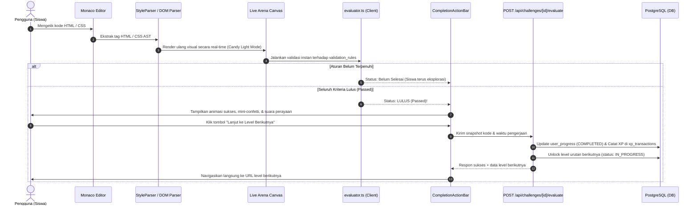
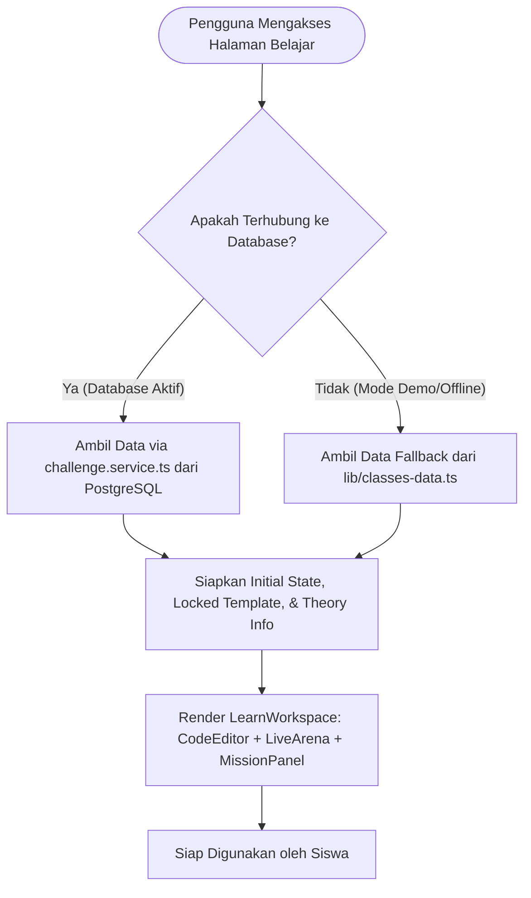
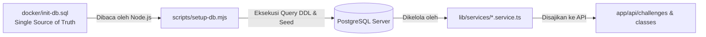

# Project Plan: Codevas (Code Canvas)
**Repository Name:** `codevas-learning-engine`

## 1. Product Vision & Purpose
**Apa itu Codevas?**
Codevas adalah platform edukasi pemrograman interaktif berbasis web (Interactive UI Learning Engine) yang mensimulasikan lingkungan kerja *developer* profesional tanpa memerlukan instalasi apa pun (*zero-setup*). Pengguna memanipulasi *template* antarmuka web modern secara *real-time* melalui penulisan kode terarah.

**Tujuan:**
Menghilangkan rasa frustrasi "kanvas kosong" bagi pelajar dengan menyajikan UI yang sudah berdesain modern (Candy Light Mode), lalu memberikan validasi visual seketika saat pengguna mengetik kode.

## 2. Tech Stack & Infrastructure
*   **Frontend:** Next.js, Tailwind CSS, Monaco Editor, Framer Motion.
*   **Backend:** Nextjs (REST API, Validation Engine).
*   **Database:** PostgreSQL.
*   **Development AI Workflow:** Google Stitch (Fase Desain Visual/UI) + Google Antigravity (Fase Slicing & Logika).
*   **Deployment:** Docker Containerized, Self-Hosted via Synology NAS (Reverse Proxy).

## 3. Desain Visual (UI/UX)
*   **Tema:** *Candy Light Mode*. Latar belakang bersih/putih dengan blok warna pastel solid (Mint Green, Bubblegum Pink, Sky Blue) tanpa gradasi.
*   **Layout Utama:** *Split-screen* (55% Live Canvas menyerupai *browser* macOS, 45% Monaco Editor & Panel Mission Control).
*   **Feedback:** Validasi instan (*auto-check*) tanpa tombol "Submit" manual untuk kategori Live Code HTML/CSS.

## 4. Database Architecture (ERD Core)
Menggunakan `JSONB` agar struktur tabel fleksibel menampung konfigurasi soal yang berbeda-beda tiap kategori.

*   **`users`**: `id` (UUID), `username`, `email`, `password_hash`, `full_name`, `avatar_url`, `xp_points`, `level`, `streak_days`, `role` (USER, ADMIN), `last_seen_at`, `created_at`, `updated_at`.
*   **`xp_transactions`** (Ledger & Audit Trail EXP): `id` (UUID), `user_id` (FK -> users), `amount`, `source` (REGISTER_BONUS, CHALLENGE_COMPLETE, STREAK_BONUS, ADMIN_GRANT), `reference_id`, `description`, `created_at`.
*   **`classes`**: `id`, `category` (ENUM: `LIVE_CODE`, `DRAG_DROP`, `QUIZ`), `title`, `description`, `is_published`.
*   **`user_enrollments`**: `id` (UUID), `user_id` (FK -> users), `class_id` (FK -> classes), `status` (ACTIVE, COMPLETED, DROPPED), `enrolled_at`.
*   **`challenges`** (Level dalam Kelas): 
    *   `id`, `class_id` (FK), `title`, `difficulty`.
    *   `instruction` (TEXT).
    *   `locked_template` (JSONB) -> *Kode boilerplate / opsi UI yang dikunci.*
    *   `initial_state` (TEXT) -> *Kondisi awal di area kerja pengguna.*
    *   `validation_rule` (JSONB) -> *Aturan kelulusan.*
*   **`user_progress`**: `id`, `user_id` (FK), `challenge_id` (FK), `status` (LOCKED, IN_PROGRESS, COMPLETED), `code_snapshot`.

## 5. Struktur Kurikulum Pembelajaran

Kurikulum dibagi berdasarkan **Kategori** (metode pendekatan belajar). Di dalam setiap kategori, terdapat beberapa **Class** (materi spesifik).

### Kategori: Live Code
*(Pengguna memanipulasi kode dengan validasi antarmuka secara real-time. Visual kanvas berupa blok wireframe modern dengan feedback instan).*

> [!NOTE]
> **Standar Bahasa & Tone Kurikulum:**
> Wajib menggunakan terminologi rekayasa web profesional dan bersih (industri standar). **DILARANG KERAS** menggunakan istilah game/slang gaming seperti *"misi"*, *"quest"*, *"menaklukkan"*, *"jurus"*, *"Boss Fight"*, atau memaksakan penggunaan kata *"status"*.

**Class 1: HTML Architecture (The Skeletons & Hierarchy)** — *20 Levels*
*   Level 1: The Raw Canvas & Floating Elements (Header `<h1>` & Biodata `<p>`)
*   Level 2: The Need for Boundaries (Bungkus ke dalam `<div>` pertama)
*   Level 3: The Named Box (Identitas Kontainer `<div class="profile-card">`)
*   Level 4: The Siblings (Dua Kontainer Bersaudara `<div class="notes-card">`)
*   Level 5: The Triple Stack (Tiga Zona Vertikal `top-bar`, `content-area`, `bottom-bar`)
*   Level 6: The Matryoshka (Nesting Kolom Ganda `bio-col` & `details-col`)
*   Level 7: The Media Frame (Bingkai Gambar Avatar `<div class="avatar-frame">`)
*   Level 8: The Media & Content Cluster (Avatar + Konten Teks)
*   Level 9: The Action Row (Pengelompokan Tombol Aksi `<div class="action-row">`)
*   Level 10: The Badge Pill (Label Kategori & Tag Profesi `<div class="badge-role">`)
*   Level 11: The Metrics Summary (3 Kolom Metrik `<div class="metrics-row">`)
*   Level 12: Capstone Project - The Modular Profile Card
*   Level 13: The Two-Panel Split (Sidebar & Main Content Layout)
*   Level 14: Sidebar Navigation Box (`brand-box` & `menu-box`)
*   Level 15: The Header Bar Cluster (Baris Navigasi Atas)
*   Level 16: The Bento Grid Foundation (Kartu-Kartu Dashboard)
*   Level 17: Interactive Input Group (Pengelompokan Form `<div class="form-group">`)
*   Level 18: The Form Stack (Struktur Form Lengkap)
*   Level 19: The Semantic Hybrid (`<header>`, `<main>`, `<footer>` + Container `<div>`)
*   Level 20: Final Project - Complete Web Dashboard Architecture

**Class 2: CSS Basics (The Fundamentals)** — *12 Levels*
*   Level 1: The Canvas (`background-color`)
*   Level 2: The Ink (`color`)
*   Level 3: Typography (`font-size`, `font-family`)
*   Level 4: The Alignment (`text-align`)
*   Level 5: The Inner Cushion (`padding`)
*   Level 6: The Independent Cushion (`padding-top`, etc.)
*   Level 7: The Outer Space (`margin`)
*   Level 8: The Symmetrical Spacer (`margin: 0 auto`)
*   Level 9: The Fence (`border`)
*   Level 10: The Smooth Edge (`border-radius`)
*   Level 11: The Elevation (`box-shadow`)
*   Level 12: Final Component - The Notification Badge

**Class 3: CSS Flexbox (The 1D Layout)** — *12 Levels*
*   Level 1: The Activation (`display: flex`)
*   Level 2: The Push to End (`justify-content: flex-end`)
*   Level 3: The Center Stage (`justify-content: center`)
*   Level 4: The Equal Space (`justify-content: space-between`)
*   Level 5: The Vertical Alignment (`align-items: center`)
*   Level 6: The Baseline Anchor (`align-items: flex-end`)
*   Level 7: The Column Reorientation (`flex-direction: column`)
*   Level 8: The Gutter (`gap`)
*   Level 9: The Wrap Around (`flex-wrap: wrap`)
*   Level 10: The Space Distributor (`flex: 1`)
*   Level 11: The Ultimate Centering (Horizontal & Vertical Center)
*   Level 12: Final Component - The Modern Navbar

**Class 4: CSS Grid (The 2D Layout)** — *12 Levels*
*   Level 1: The Blueprint (`grid-template-columns: 1fr 1fr`)
*   Level 2: The Triplets (`repeat(3, 1fr)`)
*   Level 3: The Asymmetry (Sidebar 250px + Content 1fr)
*   Level 4: The Alleyway (`gap: 24px`)
*   Level 5: The Header Expansion (`grid-column: span 3`)
*   Level 6: The Tower Expansion (`grid-row: span 2`)
*   Level 7: The Absolute Placement (`grid-column: 1 / 3`)
*   Level 8: The Row Sizing (`grid-template-rows`)
*   Level 9: The Dynamic Blueprint (`grid-template-areas`)
*   Level 10: The Semantic Area Assignment (`grid-area`)
*   Level 11: The Inception (Flexbox di dalam sel Grid)
*   Level 12: Final Layout - The Bento Box Dashboard

**Class 5: Component Styling (The Artist)** — *6 Levels (Neo-brutalism, Glassmorphism, UI Cards)*
**Class 6: Tailwind CSS (The Modern Way)** — *6 Levels (Utility Classes, Responsive, Dark Mode)*

---

### Kategori: Visual Logic (Drag & Drop) *(Roadmap)*
*   **Class: Javascript Logic Blocks**
*   **Class: CSS Layouting Hierarchy**
*   **Class: HTML DOM Tree Assembly**

---

### Kategori: Theory (Multiple Choice) *(Roadmap)*
*   **Class: CSS Selectors Quiz**
*   **Class: HTML Semantic Quiz**
*   **Class: JS Fundamentals Quiz**

---

## 6. Sesi Terakhir: Progress Summary (20-21 Oktober 2026)

### ✅ Pencapaian yang Sudah Selesai:
1. **Pembersihan Total Istilah Game & Kata "Status":**
   - Menghapus dan mengganti semua istilah game (*"misi"*, *"quest"*, *"menaklukkan"*, *"boss fight"*, *"jurus"*) di seluruh kurikulum dan UI menjadi istilah profesional (*"Panduan Tantangan"*, *"Capstone Project"*, *"Final Project"*, *"Final Component"*, *"menyelesaikan"*).
   - Menghapus referensi kata *"status"* yang dipaksakan:
     - Level 4 diubah dari *"Kartu Status Harian"* (`status-box`) menjadi *"Kartu Catatan Pengembang"* (`notes-card`).
     - Level 10 diubah dari *"Kardus Tag Status"* (`badge-status`) menjadi *"Label Kategori & Tag Profesi"* (`badge-role`).
     - Level 11 diubah dari XP status game menjadi metrik portofolio profesional riil (`metrics-row` dengan Proyek, Kontribusi, Repositori).
2. **Modularisasi Halaman Belajar (`/classes/[id]/learn/[challengeid]`):**
   - Halaman kerja belajar yang sebelumnya menumpuk telah dipisah menjadi komponen modular mandiri: `MissionPanel`, `TheoryModal`, `SyntaxHelperBar`, `CompletionActionBar`, `LiveArena`, dan `StyleParser`.
3. **Penyempurnaan Kurikulum HTML Architecture (20 Level):**
   - Dibuat bertahap dengan penekanan pada logika pembungkus `<div>` (kardus dalam kardus) dan penulisan data biodata pengguna yang nyata.
4. **Sinkronisasi Database & Evaluator:**
   - Skema dan data awal `docker/init-db.sql` telah diperbarui dan dieksekusi ke PostgreSQL lokal (56 tantangan aktif).
   - Script `scripts/setup-db.mjs` telah disederhanakan untuk membaca dan menjalankan `docker/init-db.sql` secara langsung.
   - Evaluator (`components/learn/evaluator.ts` dan `/api/challenges/[id]/evaluate/route.ts`) telah diperbarui dengan umpan balik profesional dan backward-compatibility.
5. **Verifikasi Teknis & Git:**
   - Validasi TypeScript: `npx tsc --noEmit` lolos tanpa error (0 error).
   - Seluruh perubahan telah di-commit dan di-push ke branch **`dev`**.

---

## 7. Next Session Backlog (Prioritas Kerja AI Agent Besok)

AI Agent pada sesi selanjutnya dapat langsung memprioritaskan tugas-tugas terencana berikut:

1. **📚 Interstitial Theory Checkpoints & Guided Examples (Jeda Materi & Contoh Konseptual):**
   - *Target:* Menyisipkan jeda materi teori dan contoh interaktif secara berkala (misal setiap 3-4 level atau sebelum ada sintaks/konsep baru).
   - *Tujuan:* Menjelaskan filosofi dan fungsi tag/properti secara komprehensif (*"Tag/properti ini untuk apa, kenapa kita butuh pembungkus/container ini, dan apa akibatnya jika tidak dibungkus"*), sehingga pengguna tidak bingung atau merasa tiba-tiba ada hal asing muncul tanpa pengenalan.
   - *Komponen:* Sediakan *Concept Demo / Visual Walkthrough* (contoh kode + peraga visual) sebelum pengguna masuk ke lembar latihan aktif.

2. **📱 Full Mobile Responsiveness:**
   - Tata letak split-screen pada halaman `/classes/[id]/learn/[challengeid]` agar dapat bertransisi dengan baik di layar kecil (misal menggunakan tab switcher antara *Editor Kode*, *Panduan*, dan *Pratinjau Kanvas*).
   - Mobile navigation drawer / hamburger menu pada Navbar.
   - Penyesuaian layout kartu Dashboard dan Katalog Kelas pada layar ponsel (`sm`, `md` breakpoints).

3. **🔐 Authentication dengan Auth.js (NextAuth v5) & Google OAuth:**
   - Setup App Router handler `/api/auth/[...nextauth]`.
   - Setup Google OAuth Provider.
   - Sinkronisasi sesi Google ke tabel `users` PostgreSQL.
   - Middleware proteksi rute (`/dashboard`, `/classes/[id]`).

4. **🎯 Kurikulum Bertingkat Sesuai Group Age (Age-Tiered Classes):**
   - Menyesuaikan gaya bahasa dan analogi materi berdasarkan rentang usia (6-7 th, 8-10 th, 11-13 th, 13-17 th).
   - Filter rekomendasi materi di dashboard sesuai `age_group` user.

---

## 8. Dokumentasi Struktur File & Komponen (Directory Architecture)

Proyek ini dibangun menggunakan arsitektur **Next.js App Router (v15)** dengan pemisahan tanggung jawab (*separation of concerns*) yang jelas antara presentasi antarmuka, parsing kode visual, data service, dan persistensi database.

```text
codevas/
├── app/                              # Next.js App Router (Pages, Layouts & API Endpoints)
│   ├── (auth)/                       # Routing Autentikasi Pengguna
│   │   ├── login/page.tsx            # Form login dengan email/password & Google
│   │   └── register/page.tsx         # Registrasi user baru + pemilihan age_group
│   ├── admin/                        # Panel Admin Manajemen Kurikulum
│   │   └── page.tsx                  # Dashboard admin untuk kelola class & challenge
│   ├── classes/                      # Katalog & Modul Pembelajaran
│   │   ├── page.tsx                  # Daftar seluruh kelas & filter kategori
│   │   ├── [id]/page.tsx             # Detail kelas & roadmap level/modul
│   │   └── [id]/learn/[challengeid]/ # Workspace live code interaktif
│   │       └── page.tsx              # Container loader level (fetch DB + fallback static)
│   ├── dashboard/page.tsx            # Beranda belajar siswa (streak, XP, recent progress)
│   ├── demo/page.tsx                 # Preview demo interaktif bagi pengunjung publik
│   ├── api/                          # REST API Endpoints Backend
│   │   ├── auth/                     # Autentikasi, login/register, session check
│   │   ├── classes/                  # GET katalog kelas & detail kurikulum
│   │   ├── challenges/               # GET detail soal & POST evaluasi server-side
│   │   │   └── [id]/evaluate/route.ts# Validasi backend, award XP & unlock level berikutnya
│   │   ├── enrollments/              # Status pendaftaran kelas user
│   │   ├── progress/                 # Update & fetch snapshot kode serta status level
│   │   └── admin/                    # CRUD API untuk manajemen kurikulum oleh admin
│   ├── globals.css                   # Global styles & Candy Light Mode design tokens
│   └── layout.tsx                    # Root layout, font provider, & global navigation
│
├── components/                       # Komponen UI Terisolasi & Modular
│   ├── learn/                        # 🧠 Modul Workspace Belajar (Live Code Engine)
│   │   ├── learn-workspace.tsx       # Orkestrator utama: state kode, evaluasi, & layout
│   │   ├── learn-header.tsx          # Top bar: navigasi kembali, nama level, timer, & XP reward
│   │   ├── mission-panel.tsx         # Panel instruksi: deskripsi tugas & panduan koding
│   │   ├── code-editor-panel.tsx     # Monaco Editor terintegrasi + syntax helper bar
│   │   ├── live-arena.tsx            # Kanvas pratinjau rendering real-time DOM/CSS
│   │   ├── completion-action-bar.tsx # Baris aksi sukses: mini-confetti, ringkasan XP & tombol lanjut
│   │   ├── theory-modal.tsx          # Modal penjelasan teori mendalam & analogi konsep
│   │   ├── session-expired-modal.tsx # Dialog peringatan jika sesi login kedaluwarsa
│   │   ├── evaluator.ts              # Client-side validation engine untuk auto-check instan
│   │   ├── style-parser.ts           # Parser selector CSS, style rule, & inline declaration
│   │   ├── types.ts                  # TypeScript interface spesifik komponen learn
│   │   └── use-mini-confetti.ts      # Custom hook animasi partikel perayaan penyelesaian
│   ├── classes/                      # Komponen katalog kelas, progress bar, & card list
│   ├── dashboard/                    # Komponen visual statistik siswa & kalender streak
│   ├── admin/                        # Komponen form editor soal & live preview admin
│   ├── navigation/                   # Navbar utama, breadcrumbs, & profil menu
│   └── ui/                           # Primitif UI (Button, Modal, Badge, Card, Tooltip)
│
├── lib/                              # Core Utilities, Services & Database Access
│   ├── services/                     # 🛡️ Service Layer (Database Queries PostgreSQL)
│   │   ├── challenge.service.ts      # Query level, validasi server, & logic unlock
│   │   ├── class.service.ts          # Query kelas, statistik modul, & metadata
│   │   ├── user.service.ts           # Manajemen akun, hash password, & XP ledger
│   │   ├── progress.service.ts       # Manajemen status level (LOCKED, IN_PROGRESS, COMPLETED)
│   │   └── enrollment.service.ts     # Pendaftaran siswa ke kelas pembelajaran
│   ├── db/                           # Konfigurasi pg Pool & koneksi PostgreSQL
│   ├── classes-data.ts               # Dataset statis fallback untuk demo offline / preview
│   └── gamification.ts               # Kalkulasi level siswa, penamaan rank badge, & XP tiers
│
├── docker/                           # Konfigurasi Kontainerisasi & Database
│   └── init-db.sql                   # 💎 Single Source of Truth: Skema DDL & seed 56 level
├── scripts/                          # Skrip Utilitas & Pemeliharaan
│   └── setup-db.mjs                  # Eksekutor migrasi database dari docker/init-db.sql
└── project_plan.md                   # Dokumentasi sentral rencana, progres, & arsitektur proyek
```

---

## 9. Diagram Alur Kerja & Sistem (System Execution Flows)

### 1. Alur Belajar Interaktif (Live Code & Instant Validation Loop)
Alur ketika siswa mengerjakan tantangan koding pada workspace:



### 2. Alur Pembacaan Data & Navigasi Modul (Data Fetching & Fallback Flow)
Alur bagaimana data materi dibaca dan disajikan kepada pengguna:



### 3. Alur Migrasi & Konsistensi Database (Database Sync Flow)
Alur pemeliharaan skema agar data di database selalu konsisten dengan silabus:

